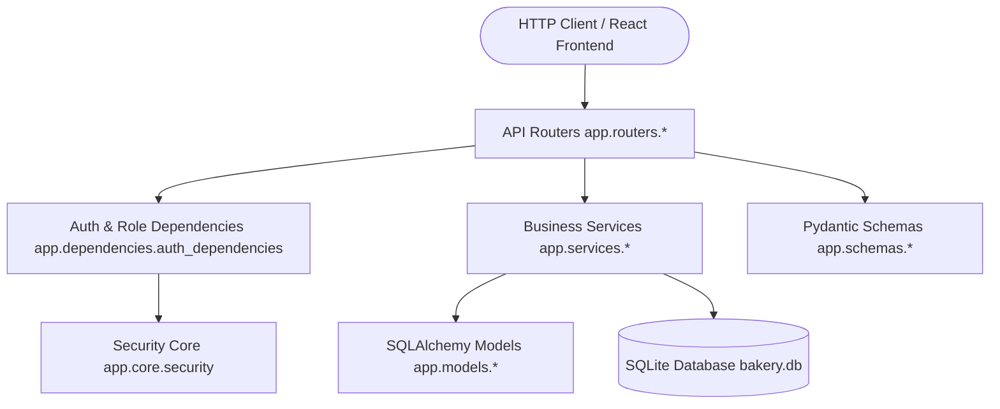
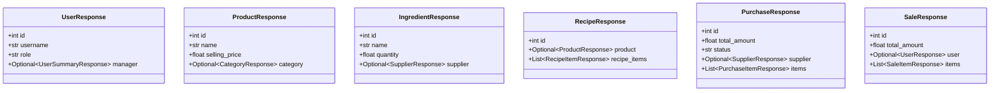
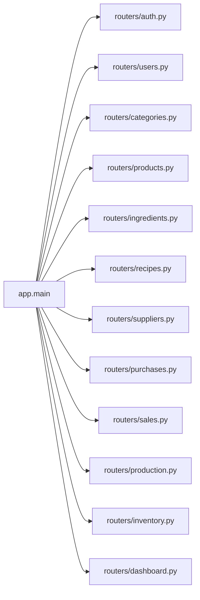

# Comprehensive System Reference: Classes, Methods, & Dependencies

This document provides an exhaustive breakdown of every **Class**, **Function/Method**, **Module**, and **Inter-component Relationship** in the **Pastry & Cake Inventory Management System** backend codebase (`backend/app`).

---

## 1. System Architecture & Flow Overview

The system is built as a modular FastAPI backend powered by SQLAlchemy ORM and Pydantic schemas.

### Request Lifecycle
1. **Client Request**: Hit an endpoint registered in `app/routers/`.
2. **Authentication & Authorization**: Handled via `get_current_user` and `require_roles` dependencies (`app/dependencies/auth_dependencies.py`), which verify JWT tokens via `app/core/security.py`.
3. **Validation & Serialization**: Input payoads are validated using Pydantic models (`app/schemas/`).
4. **Business Logic Execution**: Complex operations (sales stock deduction, production recipe checking, purchase receiving) execute inside `app/services/`.
5. **Database Interactivity**: Queries and updates execute via SQLAlchemy ORM models (`app/models/`) using the session provided by `get_db` (`app/database/database.py`).

---

## 2. Core Infrastructure & Configuration (`app.core`, `app.database`, `app.dependencies`)

### 2.1 Settings Class (`app/core/config.py`)
- **Class Name**: `Settings` (inherits `pydantic_settings.BaseSettings`)
- **Description**: Manages global application configurations and environment variables loaded from `.env`.
- **Attributes**:
  - `PROJECT_NAME` (`str`): `"Pastry & Cake Inventory Management System"`
  - `API_V1_STR` (`str`): `"/api"`
  - `DATABASE_URL` (`str`): `"sqlite:///./bakery.db"`
  - `SECRET_KEY` (`str`): JWT secret key for signature verification.
  - `ALGORITHM` (`str`): `"HS256"`
  - `ACCESS_TOKEN_EXPIRE_MINUTES` (`int`): `1440` (24 hours)
- **Usage in System**: Instantiated as `settings`. Used across `app.main`, `app.database.database`, `app.core.security`, and `app.dependencies.auth_dependencies`.

---

### 2.2 Security Utility Functions (`app/core/security.py`)
Provides hashing and token management.

- **Global Variable**: `pwd_context = CryptContext(schemes=["bcrypt"], deprecated="auto")`
- **Functions**:
  1. `verify_password(plain_password: str, hashed_password: str) -> bool`
     - **Purpose**: Verifies plain text password against stored bcrypt hash with fallback handling.
     - **Used by**: `routers/auth.py` (`login`, `login_for_access_token`).
  2. `get_password_hash(password: str) -> str`
     - **Purpose**: Generates bcrypt salted password hash.
     - **Used by**: `seed.py` (initial users setup), `routers/auth.py` (`register_user`), `routers/users.py` (`create_user`, `update_user`).
  3. `create_access_token(subject: Union[str, Any], expires_delta: Optional[timedelta] = None) -> str`
     - **Purpose**: Encodes a JWT token containing standard `sub` and `exp` claims.
     - **Used by**: `routers/auth.py`.

---

### 2.3 Database Management (`app/database/database.py`)
Configures SQLAlchemy connection engine and session factory.

- **Global Variables**:
  - `engine`: Created with `DATABASE_URL` and `check_same_thread=False` for SQLite.
  - `SessionLocal`: `sessionmaker(autocommit=False, autoflush=False, bind=engine)`.
  - `Base`: `declarative_base()`. Standard parent class for all SQLAlchemy ORM models.
- **Functions**:
  1. `get_db() -> Generator[Session, None, None]`
     - **Purpose**: Generator function serving database sessions to FastAPI routes via Dependency Injection. Ensures sessions are closed safely after request execution.
     - **Used by**: All API endpoint routers in `app/routers/*` and auth dependencies.

---

### 2.4 Authentication & Authorization Dependencies (`app/dependencies/auth_dependencies.py`)

- **Global Variable**: `oauth2_scheme = OAuth2PasswordBearer(tokenUrl="/api/auth/login")`
- **Functions**:
  1. `get_current_user(db: Session = Depends(get_db), token: str = Depends(oauth2_scheme)) -> User`
     - **Purpose**: Decodes Bearer JWT token, validates user existence in DB, and checks `is_active` status.
     - **Raises**: HTTP 401 (Unauthorized) if token invalid; HTTP 400 (Bad Request) if inactive.
     - **Used by**: Protected routers and `require_roles`.
  2. `require_roles(allowed_roles: List[str])`
     - **Purpose**: Higher-order function returning a role checker dependency (`role_checker`).
     - **Enforces**: Role-based access control (`ADMIN`, `MANAGER`, `STAFF`).
     - **Raises**: HTTP 403 (Forbidden) if `current_user.role` is not in `allowed_roles`.
     - **Used by**: `routers/users.py`, `routers/categories.py`, `routers/products.py`, `routers/ingredients.py`, `routers/recipes.py`, `routers/suppliers.py`, `routers/purchases.py`, `routers/production.py`.

---

## 3. Database ORM Layer (`app.models`)

All ORM classes inherit from `Base` (`app.database.database`).

| Class Name | Table Name | Key Purpose | Primary Relationships |
| :--- | :--- | :--- | :--- |
| **`User`** | `users` | System user accounts and authentication | Self-referencing `manager` / `staff_members` |
| **`Category`** | `categories` | Product grouping classifications | 1:N with `Product` |
| **`Supplier`** | `suppliers` | Vendors supplying raw ingredients | 1:N with `Ingredient`, 1:N with `Purchase` |
| **`Ingredient`** | `ingredients` | Raw materials/stock items | N:1 with `Supplier`, 1:N with `RecipeItem`, `PurchaseItem` |
| **`Product`** | `products` | Finished bakery items for sale | N:1 with `Category`, 1:1 with `Recipe`, 1:N with `SaleItem` |
| **`Recipe`** | `recipes` | Production instructions for a Product | 1:1 with `Product`, 1:N with `RecipeItem` |
| **`RecipeItem`** | `recipe_items` | Quantity requirement of an Ingredient in a Recipe | N:1 with `Recipe`, N:1 with `Ingredient` |
| **`Purchase`** | `purchases` | Raw material order from Supplier | N:1 with `Supplier`, 1:N with `PurchaseItem` |
| **`PurchaseItem`** | `purchase_items` | Individual line item in Purchase | N:1 with `Purchase`, N:1 with `Ingredient` |
| **`Sale`** | `sales` | Customer sale invoice | N:1 with `User` (creator), 1:N with `SaleItem` |
| **`SaleItem`** | `sale_items` | Individual product sold in a Sale | N:1 with `Sale`, N:1 with `Product` |
| **`InventoryTransaction`** | `inventory_transactions` | Audit log of all stock movements | N:1 with `User` (creator) |

---

## 4. Pydantic Schemas Layer (`app.schemas`)

Pydantic schemas handle request validation and response payload serialization.

### 4.1 Schema Classes Summary

#### Detailed Breakdown by File:
- **`app/schemas/user.py`**:
  - `UserSummaryResponse`: Compact user payload (id, username, email, role) used in nested user relations.
  - `UserBase`, `UserCreate`, `UserUpdate`, `UserResponse`: Full user management CRUD payloads.
  - `Token`, `TokenData`, `LoginRequest`: Authentication DTOs.
- **`app/schemas/category.py`**:
  - `CategoryBase`, `CategoryCreate`, `CategoryUpdate`, `CategoryResponse`: Category DTOs.
- **`app/schemas/supplier.py`**:
  - `SupplierBase`, `SupplierCreate`, `SupplierUpdate`, `SupplierResponse`: Supplier DTOs.
- **`app/schemas/ingredient.py`**:
  - `IngredientBase`, `IngredientCreate`, `IngredientUpdate`, `IngredientResponse`: Raw material DTOs. Embeds `SupplierResponse`.
- **`app/schemas/product.py`**:
  - `ProductBase`, `ProductCreate`, `ProductUpdate`, `ProductResponse`: Bakery item DTOs. Embeds `CategoryResponse`.
- **`app/schemas/recipe.py`**:
  - `RecipeItemBase`, `RecipeItemCreate`, `RecipeItemResponse`: Recipe ingredient item DTOs.
  - `RecipeBase`, `RecipeCreate`, `RecipeUpdate`, `RecipeResponse`: Full recipe DTOs. Embeds `ProductResponse` and list of `RecipeItemResponse`.
- **`app/schemas/purchase.py`**:
  - `PurchaseItemBase`, `PurchaseItemCreate`, `PurchaseItemResponse`: Line item DTOs.
  - `PurchaseBase`, `PurchaseCreate`, `PurchaseResponse`: Purchase order DTOs. Embeds `SupplierResponse` and list of `PurchaseItemResponse`.
- **`app/schemas/sale.py`**:
  - `SaleItemBase`, `SaleItemCreate`, `SaleItemResponse`: Sale item DTOs.
  - `SaleCreate`, `SaleResponse`: Invoice DTOs. Embeds `UserResponse` and list of `SaleItemResponse`.
- **`app/schemas/inventory.py`**:
  - `InventoryTransactionResponse`: Stock audit log response DTO.
  - `ProductionRequest`, `ProductionResponse`: DTOs for baking product batches.

---

## 5. Business Logic & Services Layer (`app.services`)

Encapsulates database operations, validation rules, stock tracking, and workflow automation.

### 5.1 `dashboard_service.py`
- **Function**: `get_dashboard_summary(db: Session) -> Dict[str, Any]`
  - **Logic**:
    - Calculates active product count, ingredient count.
    - Generates low-stock lists (`quantity <= minimum_stock`) and out-of-stock lists (`quantity <= 0`).
    - Aggregates daily sales, monthly sales, and monthly purchases.
    - Computes total inventory valuation (`sum(Product.quantity * Product.cost_price) + sum(Ingredient.quantity * Ingredient.cost_per_unit)`).
    - Fetches top 5 selling products via SQLAlchemy `.join(Product).group_by(...).order_by(func.sum(...).desc())`.
    - Retrieves recent 5 sales and 5 purchase orders.
    - Filters items expiring within 7 days.
  - **Interactions**: Called by `routers/dashboard.py`. Uses `Product`, `Ingredient`, `Sale`, `SaleItem`, `Purchase`.

---

### 5.2 `inventory_service.py`
- **Function**: `create_inventory_transaction(db: Session, item_type: str, item_id: int, transaction_type: str, quantity: float, reference_id: Optional[str] = None, note: Optional[str] = None, created_by: Optional[int] = None) -> InventoryTransaction`
  - **Logic**: Instantiates and adds an `InventoryTransaction` log to the DB session.
  - **Interactions**: Called internally by `production_service.py`, `purchase_service.py`, and `sales_service.py`.
- **Function**: `get_inventory_summary(db: Session)`
  - **Logic**: Fetches all products and ingredients, serializes them via Pydantic, and returns categorized stock warnings.
  - **Interactions**: Called by `routers/inventory.py`.
- **Function**: `get_expiring_items(db: Session, days_ahead: int = 7)`
  - **Logic**: Queries products and ingredients where `expiry_date <= current_time + days_ahead`.
  - **Interactions**: Called by `routers/inventory.py`.

---

### 5.3 `production_service.py`
- **Function**: `produce_product(db: Session, request: ProductionRequest, user_id: Optional[int] = None) -> Dict[str, Any]`
  - **Logic**:
    1. Validates `request.quantity > 0`.
    2. Queries `Product` and `Recipe` for `request.product_id`.
    3. **Stock Verification Step**: Iterates through `recipe.recipe_items`. Calculates required ingredient quantities (`item.quantity_required * request.quantity`). Raises HTTP 400 with missing details if stock is insufficient.
    4. **Atomic Execution Step**:
       - Deducts required quantities from `Ingredient.quantity`.
       - Logs negative `InventoryTransaction` for each ingredient (type: `PRODUCTION`).
       - Increases `Product.quantity` by `request.quantity`.
       - Logs positive `InventoryTransaction` for product (type: `PRODUCTION`).
       - Commits session atomically. Rollback on exception.
  - **Interactions**: Called by `routers/production.py`. Uses `Product`, `Recipe`, `Ingredient`, `InventoryTransaction`.

---

### 5.4 `purchase_service.py`
- **Function**: `create_purchase(db: Session, purchase_in: PurchaseCreate) -> Purchase`
  - **Logic**: Validates supplier existence, verifies each ingredient, calculates line totals, creates a `Purchase` record with `status="PENDING"`.
  - **Interactions**: Called by `routers/purchases.py`.
- **Function**: `receive_purchase(db: Session, purchase_id: int, user_id: Optional[int] = None) -> Purchase`
  - **Logic**:
    1. Fetches `Purchase` by ID. Checks if status is already `RECEIVED` or `CANCELLED`.
    2. Updates status to `RECEIVED`.
    3. Iterates over `purchase.items`: Adds `item.quantity` to `Ingredient.quantity`, updates `Ingredient.cost_per_unit = item.unit_price`.
    4. Creates `InventoryTransaction` logs (type: `PURCHASE`).
    5. Commits transaction.
  - **Interactions**: Called by `routers/purchases.py`. Uses `Purchase`, `PurchaseItem`, `Ingredient`.

---

### 5.5 `sales_service.py`
- **Function**: `create_sale(db: Session, sale_in: SaleCreate, user_id: Optional[int] = None) -> Sale`
  - **Logic**:
    1. Validates that items list is non-empty.
    2. Iterates over items: Validates product existence, checks `product.quantity >= requested_quantity`. Raises HTTP 400 if stock is insufficient.
    3. Calculates prices and total sale amount.
    4. Creates `Sale` record, flushes to retrieve `sale.id`.
    5. Deducts stock from `Product.quantity`, creates `SaleItem` records, logs negative `InventoryTransaction` logs (type: `SALE`).
    6. Commits transaction atomically.
  - **Interactions**: Called by `routers/sales.py`. Uses `Sale`, `SaleItem`, `Product`.

---

## 6. API Controllers Layer (`app.routers`)

Endpoints are wired in `app/main.py`.

### Route Functions Summary Table

| Router Module | Route Function | HTTP Method & Path | Roles Allowed | Description & Service Dependencies |
| :--- | :--- | :--- | :--- | :--- |
| **`auth.py`** | `register_user` | `POST /api/auth/register` | Open / Admin | Registers user account |
| | `login` | `POST /api/auth/login` | Open | Validates credentials, returns JWT token |
| | `login_for_access_token` | `POST /api/auth/token` | Open | OAuth2 compatible token endpoint |
| | `get_me` | `GET /api/auth/me` | Authenticated | Returns current user profile |
| **`users.py`** | `get_users` | `GET /api/users/` | ADMIN, MANAGER | Lists all users |
| | `get_managers` | `GET /api/users/managers` | ADMIN, MANAGER | Lists users with role `MANAGER` |
| | `get_user_by_id` | `GET /api/users/{user_id}` | ADMIN, MANAGER | Gets specific user details |
| | `create_user` | `POST /api/users/` | ADMIN | Creates new user with manager assignment |
| | `update_user` | `PUT /api/users/{user_id}` | ADMIN | Updates user fields/role/manager |
| | `delete_user` | `DELETE /api/users/{user_id}` | ADMIN | Deletes user record |
| **`categories.py`**| `list_categories` | `GET /api/categories/` | Authenticated | Lists categories |
| | `get_category` | `GET /api/categories/{id}` | Authenticated | Gets single category |
| | `create_category` | `POST /api/categories/` | ADMIN, MANAGER | Creates category |
| | `update_category` | `PUT /api/categories/{id}` | ADMIN, MANAGER | Updates category |
| | `delete_category` | `DELETE /api/categories/{id}`| ADMIN | Deletes category |
| **`products.py`** | `list_products` | `GET /api/products/` | Authenticated | Lists products |
| | `get_product` | `GET /api/products/{id}` | Authenticated | Gets single product |
| | `create_product` | `POST /api/products/` | ADMIN, MANAGER | Creates product |
| | `update_product` | `PUT /api/products/{id}` | ADMIN, MANAGER | Updates product |
| | `delete_product` | `DELETE /api/products/{id}` | ADMIN | Deletes product |
| **`ingredients.py`**| `list_ingredients` | `GET /api/ingredients/` | Authenticated | Lists ingredients |
| | `get_ingredient` | `GET /api/ingredients/{id}` | Authenticated | Gets single ingredient |
| | `create_ingredient`| `POST /api/ingredients/` | ADMIN, MANAGER | Creates ingredient |
| | `update_ingredient`| `PUT /api/ingredients/{id}` | ADMIN, MANAGER | Updates ingredient stock/details |
| | `delete_ingredient`| `DELETE /api/ingredients/{id}`| ADMIN | Deletes ingredient |
| **`recipes.py`** | `list_recipes` | `GET /api/recipes/` | Authenticated | Lists all recipes with items |
| | `get_recipe_by_product`| `GET /api/recipes/product/{product_id}` | Authenticated | Fetches recipe by product ID |
| | `create_recipe` | `POST /api/recipes/` | ADMIN, MANAGER | Creates recipe & items |
| | `update_recipe` | `PUT /api/recipes/{recipe_id}` | ADMIN, MANAGER | Updates recipe instructions/items |
| | `delete_recipe` | `DELETE /api/recipes/{recipe_id}` | ADMIN | Deletes recipe |
| **`suppliers.py`** | `list_suppliers` | `GET /api/suppliers/` | Authenticated | Lists suppliers |
| | `get_supplier` | `GET /api/suppliers/{id}` | Authenticated | Gets single supplier |
| | `create_supplier` | `POST /api/suppliers/` | ADMIN, MANAGER | Creates supplier |
| | `update_supplier` | `PUT /api/suppliers/{id}` | ADMIN, MANAGER | Updates supplier |
| | `delete_supplier` | `DELETE /api/suppliers/{id}`| ADMIN | Deletes supplier |
| **`purchases.py`** | `list_purchases` | `GET /api/purchases/` | Authenticated | Lists purchases |
| | `get_purchase` | `GET /api/purchases/{id}` | Authenticated | Gets single purchase |
| | `create_new_purchase`| `POST /api/purchases/` | ADMIN, MANAGER | Calls `purchase_service.create_purchase` |
| | `mark_purchase_received`| `POST /api/purchases/{id}/receive` | ADMIN, MANAGER | Calls `purchase_service.receive_purchase` |
| **`sales.py`** | `list_sales` | `GET /api/sales/` | Authenticated | Lists sales invoices |
| | `get_sale` | `GET /api/sales/{id}` | Authenticated | Gets sale details |
| | `create_new_sale` | `POST /api/sales/` | Authenticated | Calls `sales_service.create_sale` |
| **`production.py`**| `trigger_production`| `POST /api/production/produce` | ADMIN, MANAGER | Calls `production_service.produce_product` |
| **`inventory.py`** | `get_inventory` | `GET /api/inventory/summary` | Authenticated | Calls `inventory_service.get_inventory_summary` |
| | `get_low_stock` | `GET /api/inventory/low-stock` | Authenticated | Filters low stock products/ingredients |
| | `get_out_of_stock`| `GET /api/inventory/out-of-stock`| Authenticated | Filters out of stock items |
| | `get_expiring` | `GET /api/inventory/expiring` | Authenticated | Calls `inventory_service.get_expiring_items` |
| | `get_transactions`| `GET /api/inventory/transactions`| Authenticated | Queries `InventoryTransaction` logs |
| **`dashboard.py`**| `get_dashboard` | `GET /api/dashboard/` | Authenticated | Calls `dashboard_service.get_dashboard_summary` |

---

## 7. Initialization & Seeding (`app/seed.py`, `app/main.py`)

### 7.1 `seed_database(db: Session)` (`app/seed.py`)
- **Purpose**: Pre-populates database idempotently on application startup.
- **Data Seeded**:
  1. Default Users (`admin`, `manager`, `staff` with `staff.manager_id = manager.id`).
  2. Categories (`Cake`, `Pastry`, `Donut`, `Croissant`, `Muffin`, `Brownie`, `Bread`, `Other`).
  3. Suppliers (`Golden Grain Flour Co.`, `Sweet Valley Sugar & Dairy`, `Cocoa Craft Ingredients`).
  4. Ingredients (Flour, Sugar, Butter, Eggs, Cocoa Powder, etc.).
  5. Products (Chocolate Cake, Black Forest Cake, Butter Croissant, Blueberry Muffin, etc.).
  6. Recipes & RecipeItems (e.g., Chocolate Cake recipe requiring Flour, Sugar, Cocoa, Butter, Eggs, Cream).

### 7.2 `ensure_schema_migrations()` & Lifespan (`app/main.py`)
- `ensure_schema_migrations()`: Executes `PRAGMA table_info(users)` and issues `ALTER TABLE users ADD COLUMN manager_id` if missing.
- `lifespan(app: FastAPI)`: Async context manager executing `Base.metadata.create_all(bind=engine)`, running migrations, and invoking `seed_database(db)`.
