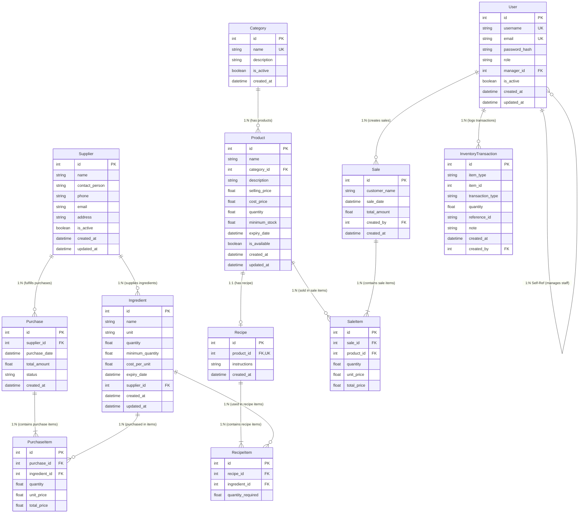

# Database Models & Entity Relationships Reference

This document provides a dedicated, in-depth reference for all **SQLAlchemy Data Models**, their **attributes**, **constraints**, and exact **Relationships** (One-to-One, One-to-Many, Many-to-Many via Junction Tables, Self-Referential, and Dynamic Log References).

---

## 1. Entity Relationship Diagram (ERD)

The diagram below visualizes all 11 database entities, foreign key directions, and relationship cardinalities.

---

## 2. Categorized Model Relationships & Cardinality

### 2.1 One-to-One Relationships (1:1)

#### `Product` ↔ `Recipe`
- **Foreign Key**: `Recipe.product_id` -> `products.id` (`unique=True`, `nullable=False`).
- **ORM Definitions**:
  - `Product.recipe = relationship("Recipe", back_populates="product", uselist=False, cascade="all, delete-orphan")`
  - `Recipe.product = relationship("Product", back_populates="recipe")`
- **Explanation**: Each finished product in the bakery has at most **one** recipe defining its bill of materials. The `uselist=False` setting guarantees a strict 1:1 relation in SQLAlchemy. Deleting a product automatically cascades and deletes its recipe.

---

### 2.2 One-to-Many Relationships (1:N)

#### 1. `Category` (1) ↔ `Product` (N)
- **Foreign Key**: `Product.category_id` -> `categories.id` (`nullable=False`).
- **ORM Definitions**:
  - `Category.products = relationship("Product", back_populates="category")`
  - `Product.category = relationship("Category", back_populates="products")`
- **Explanation**: A category (e.g., "Cake", "Pastry") groups multiple products. Every product belongs to exactly one category.

#### 2. `Supplier` (1) ↔ `Ingredient` (N)
- **Foreign Key**: `Ingredient.supplier_id` -> `suppliers.id` (`nullable=True`).
- **ORM Definitions**:
  - `Supplier.ingredients = relationship("Ingredient", back_populates="supplier")`
  - `Ingredient.supplier = relationship("Supplier", back_populates="ingredients")`
- **Explanation**: A vendor supplier provides multiple raw ingredients. An ingredient can optionally link to its primary supplier.

#### 3. `Supplier` (1) ↔ `Purchase` (N)
- **Foreign Key**: `Purchase.supplier_id` -> `suppliers.id` (`nullable=False`).
- **ORM Definitions**:
  - `Supplier.purchases = relationship("Purchase", back_populates="supplier")`
  - `Purchase.supplier = relationship("Supplier", back_populates="purchases")`
- **Explanation**: A supplier receives multiple purchase orders over time. Each purchase order is issued to one supplier.

#### 4. `Purchase` (1) ↔ `PurchaseItem` (N)
- **Foreign Key**: `PurchaseItem.purchase_id` -> `purchases.id` (`nullable=False`).
- **ORM Definitions**:
  - `Purchase.items = relationship("PurchaseItem", back_populates="purchase", cascade="all, delete-orphan")`
  - `PurchaseItem.purchase = relationship("Purchase", back_populates="items")`
- **Explanation**: A purchase order contains multiple line items. If a purchase order is deleted, all associated `PurchaseItem` records are deleted via `cascade="all, delete-orphan"`.

#### 5. `Ingredient` (1) ↔ `PurchaseItem` (N)
- **Foreign Key**: `PurchaseItem.ingredient_id` -> `ingredients.id` (`nullable=False`).
- **ORM Definitions**:
  - `Ingredient.purchase_items = relationship("PurchaseItem", back_populates="ingredient")`
  - `PurchaseItem.ingredient = relationship("Ingredient", back_populates="purchase_items")`
- **Explanation**: An ingredient can be ordered across multiple purchase order items over time.

#### 6. `Recipe` (1) ↔ `RecipeItem` (N)
- **Foreign Key**: `RecipeItem.recipe_id` -> `recipes.id` (`nullable=False`).
- **ORM Definitions**:
  - `Recipe.recipe_items = relationship("RecipeItem", back_populates="recipe", cascade="all, delete-orphan")`
  - `RecipeItem.recipe = relationship("Recipe", back_populates="recipe_items")`
- **Explanation**: A recipe consists of multiple ingredient lines (e.g., 0.5kg Flour, 4 Eggs). Deleting a recipe automatically deletes its constituent items.

#### 7. `Ingredient` (1) ↔ `RecipeItem` (N)
- **Foreign Key**: `RecipeItem.ingredient_id` -> `ingredients.id` (`nullable=False`).
- **ORM Definitions**:
  - `Ingredient.recipe_items = relationship("RecipeItem", back_populates="ingredient")`
  - `RecipeItem.ingredient = relationship("Ingredient", back_populates="recipe_items")`
- **Explanation**: A raw ingredient (e.g., Flour) can be required in multiple product recipes.

#### 8. `Sale` (1) ↔ `SaleItem` (N)
- **Foreign Key**: `SaleItem.sale_id` -> `sales.id` (`nullable=False`).
- **ORM Definitions**:
  - `Sale.items = relationship("SaleItem", back_populates="sale", cascade="all, delete-orphan")`
  - `SaleItem.sale = relationship("Sale", back_populates="items")`
- **Explanation**: An invoice sale contains multiple product items sold. Deleting a sale deletes its line items.

#### 9. `Product` (1) ↔ `SaleItem` (N)
- **Foreign Key**: `SaleItem.product_id` -> `products.id` (`nullable=False`).
- **ORM Definitions**:
  - `Product.sale_items = relationship("SaleItem", back_populates="product")`
  - `SaleItem.product = relationship("Product", back_populates="sale_items")`
- **Explanation**: A bakery product can appear across multiple sales receipts.

#### 10. `User` (1) ↔ `Sale` (N)
- **Foreign Key**: `Sale.created_by` -> `users.id` (`nullable=True`).
- **ORM Definitions**:
  - `User.sales` (accessed implicitly / via query)
  - `Sale.user = relationship("User")`
- **Explanation**: Tracks which staff/user created the sale invoice.

#### 11. `User` (1) ↔ `InventoryTransaction` (N)
- **Foreign Key**: `InventoryTransaction.created_by` -> `users.id` (`nullable=True`).
- **ORM Definitions**:
  - `InventoryTransaction.user = relationship("User")`
- **Explanation**: Tracks which user initiated stock operations (baking production, manual adjustment, purchase arrival).

---

### 2.3 Many-to-Many Relationships (N:M) via Association / Junction Tables

The architecture utilizes three explicit **Association Models** with custom attribute payloads rather than basic secondary tables:

#### 1. `Recipe` ↔ `Ingredient` (via `RecipeItem`)
- **Junction Entity**: `RecipeItem`
- **Payload Attribute**: `quantity_required` (`Float`) — quantity per product unit.
- **Role**: Connects multiple recipes to multiple ingredients with specific proportions.

#### 2. `Purchase` ↔ `Ingredient` (via `PurchaseItem`)
- **Junction Entity**: `PurchaseItem`
- **Payload Attributes**: `quantity` (`Float`), `unit_price` (`Float`), `total_price` (`Float`).
- **Role**: Connects purchase orders to raw materials, preserving historical purchase price snapshots.

#### 3. `Sale` ↔ `Product` (via `SaleItem`)
- **Junction Entity**: `SaleItem`
- **Payload Attributes**: `quantity` (`Float`), `unit_price` (`Float`), `total_price` (`Float`).
- **Role**: Connects customer sales invoices to bakery products sold, locking in the price at time of sale.

---

### 2.4 Self-Referential / Recursive Relationship (1:N)

#### `User` (Manager) ↔ `User` (Staff Members)
- **Foreign Key**: `User.manager_id` -> `users.id` (`nullable=True`).
- **ORM Definition**:
  - `User.manager = relationship("User", remote_side=[id], foreign_keys=[manager_id], backref="staff_members")`
- **Explanation**: Allows organizational hierarchy management. A staff member user links to their supervisor/manager (`manager_id`). A manager accesses their direct reports via `user.staff_members`.

---

### 2.5 Dynamic / Polymorphic Reference Log

#### `InventoryTransaction`
- **Fields**:
  - `item_type` (`String`: `"PRODUCT"` or `"INGREDIENT"`)
  - `item_id` (`Integer`: ID of target `Product` or `Ingredient`)
  - `transaction_type` (`String`: `"PURCHASE"`, `"SALE"`, `"PRODUCTION"`, `"WASTAGE"`, `"ADJUSTMENT"`, `"RETURN"`)
  - `quantity` (`Float`: Positive for stock addition, negative for deduction)
- **Explanation**: Serves as an immutable audit trail. Rather than maintaining separate log tables, `item_type` dynamically defines whether `item_id` references `products.id` or `ingredients.id`.

---

## 3. Comprehensive Model Specifications Table

| Model Class | Attribute Name | Data Type | Key / Constraint | Default / OnUpdate | Nullable | Description |
| :--- | :--- | :--- | :--- | :--- | :--- | :--- |
| **`User`** | `id` | `Integer` | Primary Key | Auto-increment | False | User ID |
| | `username` | `String` | Unique, Indexed | - | False | Unique handle |
| | `email` | `String` | Unique, Indexed | - | False | Contact email |
| | `password_hash`| `String` | - | - | False | Bcrypt hashed password |
| | `role` | `String` | - | `"STAFF"` | False | Role (`ADMIN`, `MANAGER`, `STAFF`) |
| | `manager_id` | `Integer` | Foreign Key (`users.id`) | - | True | ID of assigned manager |
| | `is_active` | `Boolean` | - | `True` | False | Account active flag |
| | `created_at` | `DateTime` | - | `datetime.utcnow` | False | Record creation time |
| | `updated_at` | `DateTime` | - | `datetime.utcnow` (onupdate) | False | Record update time |
| **`Category`** | `id` | `Integer` | Primary Key | Auto-increment | False | Category ID |
| | `name` | `String` | Unique, Indexed | - | False | Category name |
| | `description` | `String` | - | - | True | Description |
| | `is_active` | `Boolean` | - | `True` | False | Active status |
| | `created_at` | `DateTime` | - | `datetime.utcnow` | False | Creation timestamp |
| **`Supplier`** | `id` | `Integer` | Primary Key | Auto-increment | False | Supplier ID |
| | `name` | `String` | Indexed | - | False | Business name |
| | `contact_person`| `String` | - | - | True | Primary contact name |
| | `phone` | `String` | - | - | True | Phone number |
| | `email` | `String` | - | - | True | Email address |
| | `address` | `String` | - | - | True | Street address |
| | `is_active` | `Boolean` | - | `True` | False | Active status |
| | `created_at` | `DateTime` | - | `datetime.utcnow` | False | Creation timestamp |
| | `updated_at` | `DateTime` | - | `datetime.utcnow` (onupdate) | False | Update timestamp |
| **`Ingredient`**| `id` | `Integer` | Primary Key | Auto-increment | False | Ingredient ID |
| | `name` | `String` | Indexed | - | False | Ingredient name |
| | `unit` | `String` | - | - | False | Measurement unit (KG, GRAM, LITER, ML, PIECE) |
| | `quantity` | `Float` | - | `0.0` | False | Current stock level |
| | `minimum_quantity`| `Float`| - | `10.0` | False | Reorder threshold |
| | `cost_per_unit`| `Float` | - | `0.0` | False | Current unit cost price |
| | `expiry_date` | `DateTime` | - | - | True | Batch expiration date |
| | `supplier_id` | `Integer` | Foreign Key (`suppliers.id`)| - | True | Primary supplier reference |
| | `created_at` | `DateTime` | - | `datetime.utcnow` | False | Creation timestamp |
| | `updated_at` | `DateTime` | - | `datetime.utcnow` (onupdate) | False | Update timestamp |
| **`Product`** | `id` | `Integer` | Primary Key | Auto-increment | False | Product ID |
| | `name` | `String` | Indexed | - | False | Product name |
| | `category_id` | `Integer` | Foreign Key (`categories.id`) | - | False | Category reference |
| | `description` | `String` | - | - | True | Product description |
| | `selling_price`| `Float` | - | - | False | Retail selling price |
| | `cost_price` | `Float` | - | `0.0` | False | Production cost price |
| | `quantity` | `Float` | - | `0.0` | False | Finished stock on hand |
| | `minimum_stock`| `Float` | - | `5.0` | False | Warning stock limit |
| | `expiry_date` | `DateTime` | - | - | True | Product expiration date |
| | `is_available` | `Boolean` | - | `True` | False | Available for sale flag |
| | `created_at` | `DateTime` | - | `datetime.utcnow` | False | Creation timestamp |
| | `updated_at` | `DateTime` | - | `datetime.utcnow` (onupdate) | False | Update timestamp |
| **`Recipe`** | `id` | `Integer` | Primary Key | Auto-increment | False | Recipe ID |
| | `product_id` | `Integer` | FK (`products.id`), Unique | - | False | Finished product link |
| | `instructions`| `String` | - | - | True | Preparation/baking steps |
| | `created_at` | `DateTime` | - | `datetime.utcnow` | False | Creation timestamp |
| **`RecipeItem`**| `id` | `Integer` | Primary Key | Auto-increment | False | Recipe Item ID |
| | `recipe_id` | `Integer` | Foreign Key (`recipes.id`)| - | False | Parent recipe reference |
| | `ingredient_id`| `Integer` | Foreign Key (`ingredients.id`) | - | False | Required raw material |
| | `quantity_required`| `Float`| - | - | False | Quantity required per product unit |
| **`Purchase`** | `id` | `Integer` | Primary Key | Auto-increment | False | Purchase ID |
| | `supplier_id` | `Integer` | Foreign Key (`suppliers.id`)| - | False | Supplier reference |
| | `purchase_date`| `DateTime` | - | `datetime.utcnow` | False | Order issuance date |
| | `total_amount` | `Float` | - | `0.0` | False | Aggregated order cost |
| | `status` | `String` | - | `"PENDING"` | False | Status (`PENDING`, `RECEIVED`, `CANCELLED`) |
| | `created_at` | `DateTime` | - | `datetime.utcnow` | False | Creation timestamp |
| **`PurchaseItem`**| `id` | `Integer` | Primary Key | Auto-increment | False | Line item ID |
| | `purchase_id` | `Integer` | Foreign Key (`purchases.id`) | - | False | Purchase order reference |
| | `ingredient_id`| `Integer` | Foreign Key (`ingredients.id`) | - | False | Ordered ingredient reference |
| | `quantity` | `Float` | - | - | False | Quantity ordered |
| | `unit_price` | `Float` | - | - | False | Cost price per unit |
| | `total_price` | `Float` | - | - | False | Subtotal (`quantity * unit_price`) |
| **`Sale`** | `id` | `Integer` | Primary Key | Auto-increment | False | Sale invoice ID |
| | `customer_name`| `String` | - | - | True | Customer name |
| | `sale_date` | `DateTime` | - | `datetime.utcnow` | False | Sale execution date |
| | `total_amount` | `Float` | - | `0.0` | False | Total revenue collected |
| | `created_by` | `Integer` | Foreign Key (`users.id`)| - | True | Cashier/staff user ID |
| | `created_at` | `DateTime` | - | `datetime.utcnow` | False | Creation timestamp |
| **`SaleItem`** | `id` | `Integer` | Primary Key | Auto-increment | False | Line item ID |
| | `sale_id` | `Integer` | Foreign Key (`sales.id`) | - | False | Parent sale reference |
| | `product_id` | `Integer` | Foreign Key (`products.id`) | - | False | Product sold reference |
| | `quantity` | `Float` | - | - | False | Units sold |
| | `unit_price` | `Float` | - | - | False | Price per unit at time of sale |
| | `total_price` | `Float` | - | - | False | Line subtotal (`quantity * unit_price`) |
| **`InventoryTransaction`**| `id` | `Integer` | Primary Key | Auto-increment | False | Audit log ID |
| | `item_type` | `String` | - | - | False | `"PRODUCT"` or `"INGREDIENT"` |
| | `item_id` | `Integer` | - | - | False | Target `Product.id` or `Ingredient.id` |
| | `transaction_type`| `String`| - | - | False | `"PURCHASE"`, `"SALE"`, `"PRODUCTION"`, `"WASTAGE"`, `"ADJUSTMENT"`, `"RETURN"` |
| | `quantity` | `Float` | - | - | False | Delta adjustment (+ or -) |
| | `reference_id` | `String` | - | - | True | Document reference (e.g. `"SALE-12"`, `"PROD-5"`) |
| | `note` | `String` | - | - | True | Description or reason |
| | `created_at` | `DateTime` | - | `datetime.utcnow` | False | Transaction timestamp |
| | `created_by` | `Integer` | Foreign Key (`users.id`)| - | True | Performing user ID |

---

## 4. Summary of Cascade Behaviors & Deletion Rules

| Parent Model | Child Model | Cascade Option | Deletion Impact |
| :--- | :--- | :--- | :--- |
| `Product` | `Recipe` | `cascade="all, delete-orphan"` | Deleting a product automatically deletes its single recipe. |
| `Recipe` | `RecipeItem` | `cascade="all, delete-orphan"` | Deleting a recipe automatically deletes all its recipe item components. |
| `Purchase` | `PurchaseItem` | `cascade="all, delete-orphan"` | Deleting a purchase order removes all associated item rows. |
| `Sale` | `SaleItem` | `cascade="all, delete-orphan"` | Deleting a sale invoice cleans up all sold product item line records. |
